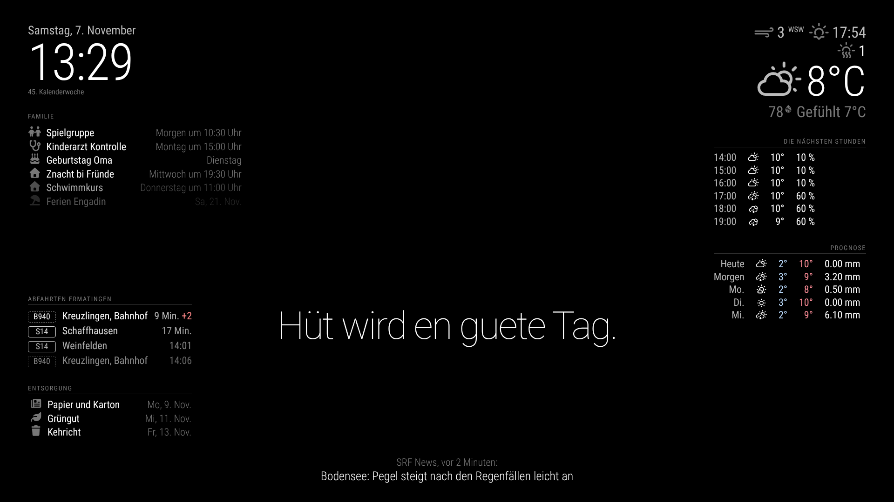

# Magic Mirror aus einem alten Samsung TV

Ein smarter Spiegel für den Familienalltag: Ein ausgedienter Samsung-Fernseher wird hinter einer Spiegelscheibe montiert und zeigt Uhrzeit, Wetter, Familienkalender und Nachrichten an. Wo der Bildschirm schwarz ist, wirkt die Fläche wie ein normaler Spiegel.

## Grundprinzip

Der Fernseher dient nur noch als Monitor. Die eigentliche Intelligenz liefert ein Raspberry Pi, der per HDMI angeschlossen ist und die Open-Source-Software [MagicMirror²](https://magicmirror.builders) ausführt. Davor sitzt ein teildurchlässiger Spiegel (Spionspiegel), der helle Schrift durchlässt und dunkle Flächen spiegelt.

```
[ Spiegelscheibe ] -> [ Samsung TV ] <-HDMI- [ Raspberry Pi ] <-WLAN-> Internet
                         ^                        |
                         +-------- HDMI-CEC ------+  (TV ein/aus nach Wochenplan und Sensor)
```

Die Smart-TV-Funktionen von Samsung (Tizen) werden bewusst nicht genutzt. Ältere Modelle erhalten keine Updates mehr, und ein Browser auf dem TV lässt sich kaum zuverlässig im Dauerbetrieb steuern.



## Projektstruktur

| Pfad | Inhalt |
| --- | --- |
| `docs/hardware.md` | Einkaufsliste, Vorbereitung des TVs, Rahmenbau, Sicherheit |
| `docs/tv-ue55ku6070.md` | Daten und Einschätzung zu unserem Samsung TV |
| `docs/software.md` | Installation von Raspberry Pi OS und MagicMirror², Arbeit per SSH |
| `docs/einrichten.md` | Persönliche Angaben eintragen und den Spiegel anpassen |
| `docs/bewegungssensor.md` | Sensor: Anschluss, Durchgangsbereich, Gesten |
| `docs/konzept-steuerung.md` | Konzept der Steuerzentrale mit Wochenplan, Sensor, Gesten und App |
| `docs/sensor-test.md` | Checkliste: Steuerzentrale in Betrieb nehmen und Sensor testen |
| `config/config.js` | MagicMirror²-Konfiguration (Deutsch, Standort Ermatingen) |
| `config/custom.css` | Anpassungen am Erscheinungsbild für Spiegelbetrieb |
| `config/secrets.example.js` | Vorlage für Persönliches (Kalender, Geburtstage, PIN der Pinnwand) |
| `modules/MMM-OeV` | Eigenes Modul: nächste Abfahrten ab Ermatingen |
| `modules/MMM-Regenradar` | Eigenes Modul: Regenradar von MeteoSchweiz auf swisstopo-Karte, letzte Stunde animiert |
| `modules/spiegel-app` | Handy-App und gemeinsamer Server (Port 8081, PIN-geschützt) |
| `modules/MMM-Steuerung` | Eigenes Modul: Steuerzentrale mit Wochenplan, Sensor, Gesten und Ansichten |
| `modules/MMM-Pinnwand` | Eigenes Modul: To-dos, Familiennachricht, Sprüche und Erinnerungen |
| `modules/MMM-Wochenplan` | Eigenes Modul: Familientermine der nächsten sieben Tage als Raster |
| `scripts/warten.html` | Schwarze Startseite, damit der Spiegel nach dem Einschalten schneller erscheint |
| `scripts/install.sh` | Automatisierte Installation auf dem Raspberry Pi |
| `scripts/sensor.py` | Liest den Ultraschallsensor, wird von der Steuerung gestartet |
| `scripts/fernzugriff.sh` | Zugriff von unterwegs über Tailscale einrichten |
| `scripts/update.sh` | Neuesten Stand holen und Spiegel neu laden |
| `scripts/ausrichtung.sh` | Bild dauerhaft ins Hochformat drehen |
| `scripts/bildschirm.sh` | TV per HDMI-CEC ein- und ausschalten |
| `scripts/kiosk-modus.sh` | Anzeige über Chromium statt Electron (für den Pi 3) |

## Vorgehen in Etappen

1. **Software testen:** MagicMirror² zuerst am normalen Fernseher ohne Spiegel einrichten. So lassen sich Module und Layout bequem ausprobieren.
2. **TV prüfen:** Gewicht, Tiefe, Anschlüsse und Stromverbrauch des Geräts festhalten (siehe `docs/hardware.md`).
3. **Spiegel und Rahmen:** Erst bestellen, wenn die genauen Masse des Panels bekannt sind.
4. **Montage und Dauerbetrieb:** Zeitplan, Belüftung und Kabelführung abschliessen.
5. **Steuerzentrale:** Wochenplan, Sensor im Durchgangsbereich, Gesten und Handy-App (`docs/konzept-steuerung.md`, `docs/sensor-test.md`).

## Stand

- **TV:** Samsung UE55KU6070 (55 Zoll, 4K, 2016), Details in `docs/tv-ue55ku6070.md`
- **Kalender:** Outlook.com (Hotmail), Anleitung in `docs/software.md`
- **Rechner:** Raspberry Pi 3 mit Raspberry Pi OS 64-bit (Debian 13), Anzeige über Chromium im Kiosk-Modus
- **Software:** MagicMirror² 2.38 läuft im Keller am Samsung, Konfiguration siehe `docs/einrichten.md`
- **Ausrichtung:** Hochformat (`scripts/ausrichtung.sh`, Layout über `AUSRICHTUNG` in `config/config.js`)
- **Wand:** Schweizer Lochziegel, Verputz ca. 1 bis 2 mm, ohne Schlag bohren (siehe `docs/hardware.md`)

## Offene Punkte

- Genauer Standort an der Wand
- Masse und VESA-Abstand des TVs nachmessen
- Stromversorgung: Steckdose hinter dem TV vorhanden oder nachrüsten?
