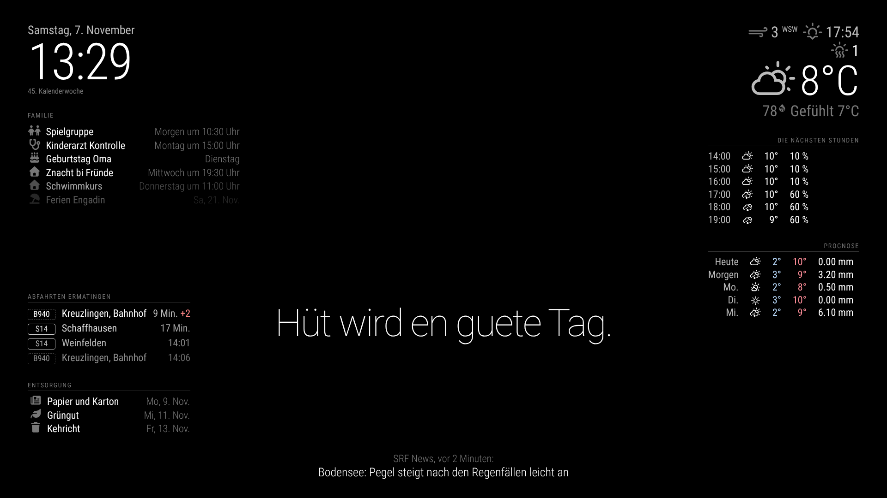

# Spiegel einrichten und anpassen

So sieht der Spiegel mit der aktuellen Konfiguration aus (Beispieldaten):



| Bereich | Inhalt |
| --- | --- |
| Oben links | Uhr mit Datum und Kalenderwoche |
| Oben rechts | Aktuelles Wetter in Ermatingen und Prognose für fünf Tage |
| Mitte | Frei fürs Spiegelbild, darunter ein Spruch in Mundart (je nach Tageszeit, Wetter, Feiertag und Geburtstag) |
| Unten links | Regenradar von MeteoSchweiz der letzten Stunde (eigenes Modul `MMM-Regenradar`) |
| Unten rechts | Zug ab Ermatingen, Bus ab Friedhof nach Weinfelden (eigenes Modul `MMM-OeV`) |
| Unten, volle Breite | Wochenplan der Familie für die nächsten sieben Tage (eigenes Modul `MMM-Wochenplan`) |
| Ganz unten | SRF News |

Das Layout ist fürs Hochformat ausgelegt. Mit `AUSRICHTUNG = "quer"` oben in `config/config.js` verteilt es sich automatisch für ein Querformat.

## 1. Neuesten Stand auf den Pi holen

Per SSH auf dem Pi:

```bash
cd ~/magicmirror-setup && git pull
```

Da seit der Installation neue Bestandteile dazugekommen sind (ÖV-Modul, automatischer Kiosk-Modus auf dem Pi 3), einmal das Installationsskript laufen lassen. Diesmal geht es schneller, weil vieles schon da ist:

```bash
bash ~/magicmirror-setup/scripts/install.sh
```

Künftig reicht für Änderungen dieser kurze Befehl:

```bash
bash ~/magicmirror-setup/scripts/update.sh
```

## 2. Persönliche Angaben eintragen

Alles Persönliche steht in `config/secrets.js`. Diese Datei existiert nur auf dem Pi und wird nie ins öffentliche Repository hochgeladen.

```bash
cp ~/magicmirror-setup/config/secrets.example.js ~/magicmirror-setup/config/secrets.js
```

```bash
nano ~/magicmirror-setup/config/secrets.js
```

| Eintrag | Was hinein gehört | Wo man es findet |
| --- | --- | --- |
| `calendars` | ICS-Link des Outlook-Kalenders | Outlook.com: Einstellungen > Kalender > Freigegebene Kalender > Kalender veröffentlichen |
| `geburtstage` | Namen und Daten der Familie | Format `{ name: "Anna", datum: "03-15" }` |
| `gehzeitHaltestelle` | Minuten bis zum Bahnhof | Verbindungen, die man nicht mehr erreicht, werden ausgeblendet |

Danach neu laden:

```bash
pm2 restart MagicMirror
```

## 3. Eigene Note geben

Alles Folgende steht in `config/config.js` und wird am besten am PC bearbeitet, committet und dann mit `update.sh` auf den Pi geholt.

- **Sprüche:** Im Block `sprueche` eigene Sätze ergänzen, zum Beispiel Familienwitze oder Sprüche, die die Kinder lustig finden. Schlüssel wie `"....-12-06"` gelten an einem bestimmten Tag jedes Jahr.
- **Kalendersymbole:** Unter `customEvents` Stichworte und Symbole ergänzen. Enthält ein Termin das Stichwort, erscheint das Symbol. Symbole gibt es unter [fontawesome.com/icons](https://fontawesome.com/search?ic=free).
- **Haltestelle:** `HALTESTELLE` oben in der Datei. Für eine Bushaltestelle den genauen Namen aus dem SBB-Fahrplan verwenden, z. B. `"Ermatingen, Bahnhof"`.
- **Farben und Grössen:** In `config/custom.css`. Hinter dem Spiegel wirkt alles dunkler als am normalen Bildschirm, darum Änderungen immer erst hinter der Scheibe beurteilen.

## 4. Spiegel-App auf dem Handy

Die App hat zwei Reiter:

- **Pinnwand:** To-dos (erscheinen unter der Uhr), eine Nachricht an die Familie (gross in der Mitte anstelle des Spruchs, bis sie abläuft) sowie eigene **Sprüche und Erinnerungen**. Ein Spruch mit Datum erscheint nur an diesem Tag und hat dann Vorrang.
- **Steuerung:** Status, Sofort an/aus, Ansicht wählen, Wochenplan und Sensor einstellen. Details im [Konzept](konzept-steuerung.md).

1. In `secrets.js` eine PIN setzen. Ohne PIN bleibt die App gesperrt, mit PIN braucht jeder Zugriff sie, auch das Lesen:

```bash
nano ~/magicmirror-setup/config/secrets.js
```

   Dort die Zeile `pinnwandPin: "1234",` mit eigener PIN ergänzen und mit `pm2 restart MagicMirror` neu laden.

2. Auf dem Handy im selben WLAN öffnen: `http://spiegel.local:8081`

3. Im Browser «Zum Home-Bildschirm hinzufügen» wählen. Danach öffnet sich die Spiegel-App wie eine App.

Beim ersten Öffnen fragt die App nach der PIN, beim ersten Eintrag nach dem Namen, und merkt sich beides auf dem Handy. Nach 5 falschen PINs ist die App für 5 Minuten gesperrt.

Findet das Handy `spiegel.local` nicht (kommt bei manchen Android-Geräten vor), stattdessen die IP-Adresse des Pi verwenden. Sie wird auf dem Pi mit `hostname -I` angezeigt. Damit sie gleich bleibt, im Router für den Pi eine feste Adresse reservieren.

Von unterwegs erreichbar wird die App über Tailscale, siehe [Checkliste](sensor-test.md), Schritt 7.

Die App läuft auf einem eigenen Port. Der eigentliche Spiegel bleibt bewusst nur auf dem Pi erreichbar, weil MagicMirror² seine ganze Konfiguration samt Kalenderlinks an jeden Browser herausgibt. Die Daten liegen auf dem Pi in `~/.config/magicmirror-pinnwand.json` und `~/.config/magicmirror-steuerung.json`. Erledigte To-dos verschwinden nach sieben Tagen von selbst.

## 5. Regenradar

Das Radar stammt von MeteoSchweiz (Open Government Data, Quelle MeteoSchweiz), die Karte von swisstopo. Ein Python-Skript auf dem Pi holt alle fünf Minuten das neueste Radarbild (1 km Auflösung) und rechnet die letzte Stunde in Bilder um. Es braucht dafür drei Pakete, die das Installationsskript mitinstalliert. Bei einer bestehenden Installation einmal von Hand:

```bash
sudo apt-get install -y python3-h5py python3-numpy python3-pil
```

Die Dateien liegen in `~/.cache/magicmirror-radar` und werden laufend aufgeräumt. Ausschnitt und Grösse lassen sich in `config/config.js` beim Modul `MMM-Regenradar` ändern (`breiteKm`, `hoeheKm`).

## Ideen für später

- Thurgauer Schulferien als eigener Kalender
- Wassertemperatur des Bodensees
- Morgens und abends unterschiedliche Module (z. B. Abfahrten nur morgens)
- Anwesenheitssensor, siehe `docs/bewegungssensor.md`
